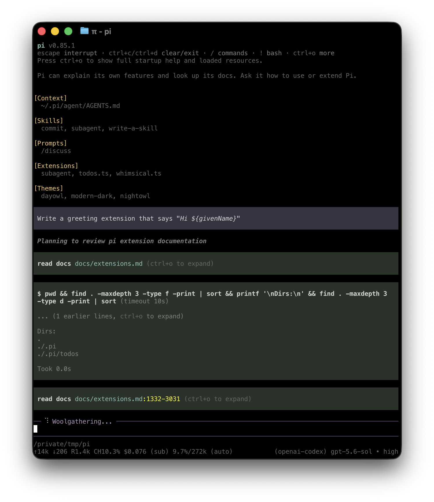

# Quickstart

Toucan runs in your terminal and works with files on your machine. To use it, you need access to a model through a supported provider. This can be a subscription, an API key, or a local model.

For native Windows setup, read [Windows Setup](windows.md). For Android, read [Termux Setup](termux.md).

## 1. Install Toucan

Install Toucan with the installer on macOS, Linux, or Windows:

```bash tab="macOS / Linux"
curl -fsSL https://pi.dev/install.sh | sh
```

```powershell tab="Windows"
powershell -c "irm https://pi.dev/install.ps1 | iex"
```

Both installers pin all dependencies and update Toucan with `toucan update`. Alternatively, install Toucan from npm, which does not pin transitive dependencies. This requires Node.js 22.19 or newer:

```bash
npm install -g --ignore-scripts @hyzek/toucan-coding-agent
```

Toucan does not require dependency lifecycle scripts for a normal npm installation.

With Nix on macOS or Linux, install the latest release from Toucan's flake. Nix builds Toucan from source:

```bash
nix profile add github:hyzek/toucan/stable
```

Older Nix versions use `nix profile install` instead. Update with `nix profile upgrade toucan`; `toucan update` cannot update a Nix installation. To pin a release, use a tag such as `github:hyzek/toucan/v1.0.0`.

Verify the installation:

```bash
toucan --version
```

## 2. Start Toucan

Change to the folder you want Toucan to work with, then start it:

```bash
cd /path/to/folder
toucan
```

The working folder helps Toucan discover relevant files, instructions, and configuration. Toucan also uses it to group saved sessions.

<p align="center"></p>

The interface shows your conversation, an editor for prompts and commands, and a footer with the current folder, model, and session status. See [Use Toucan in the terminal](usage.md) to learn how to add files, run commands, direct ongoing work, and manage results.

## 3. Choose a model

A **model** generates Toucan's responses. A **provider** is the service or account Toucan uses to access that model.

In Toucan, run:

```text
/login
```

Choose a provider, then follow the prompts to use a subscription or store an API key. Run `/model` afterward if you want to select a different available model.

See [Choose a model and provider](models.md) for supported providers, environment-variable authentication, local models, and custom endpoints.

## 4. Give Toucan a task

Toucan shows each file read, search, command, and edit it performs. It does not ask before every tool call.

Enter a task that matches your work, for example:

```text
Summarize @meeting-notes.md and save the action items to action-items.md.
```

```text
Explain how this repository is structured and how to run its checks.
```

```text
Compare @previous.csv with @current.csv and summarize the important changes.
```

Type `@` in the editor to search for a file instead of entering its full path. When Toucan finishes, review its response and any changed files. Use version control or backups for important work. For untrusted or unattended work, use a container or another sandbox. See [Security](security.md).

## Continue later

Toucan saves sessions automatically. Exit Toucan, then resume the most recent session for the same working folder with:

```bash
toucan --continue
```

Use `/resume` to choose another saved session. See [Continue or branch a session](sessions.md) for session naming, branching, compaction, export, and sharing.

## Next steps

- [Use Toucan interactively](usage.md) to learn input, commands, shortcuts, and queued messages.
- [Add instructions](configuration.md#context-files) that Toucan should follow whenever it works in a folder.
- [Choose a model and provider](models.md).

### Choose how to customize Toucan

Start with the least powerful mechanism that meets your need:

| Need | Start with |
|---|---|
| Give Toucan persistent instructions for a folder | [`AGENTS.md`](configuration.md#context-files) |
| Reuse a prompt from the `/` menu | [Prompt template](prompt-templates.md) |
| Add task-specific instructions and supporting files | [Skill](skills.md) |
| Add executable tools, commands, or event handlers | [Extension](extensions.md) |
| Build a custom terminal component | [Terminal UI](tui.md) |
| Connect an unsupported model service | [Custom provider](custom-provider.md) |
| Install or distribute several resources | [Toucan package](packages.md) |

## Uninstall Toucan

If you installed Toucan with npm, run:

```bash
npm uninstall -g @hyzek/toucan-coding-agent
```

If you used the installer, run it again and choose **Uninstall Toucan**:

```bash
curl -fsSL https://pi.dev/install.sh | sh
```

If you installed Toucan with Nix, run:

```bash
nix profile remove toucan
```

None of these methods removes configuration, credentials, sessions, or installed Toucan packages from `~/.toucan/agent/`.
